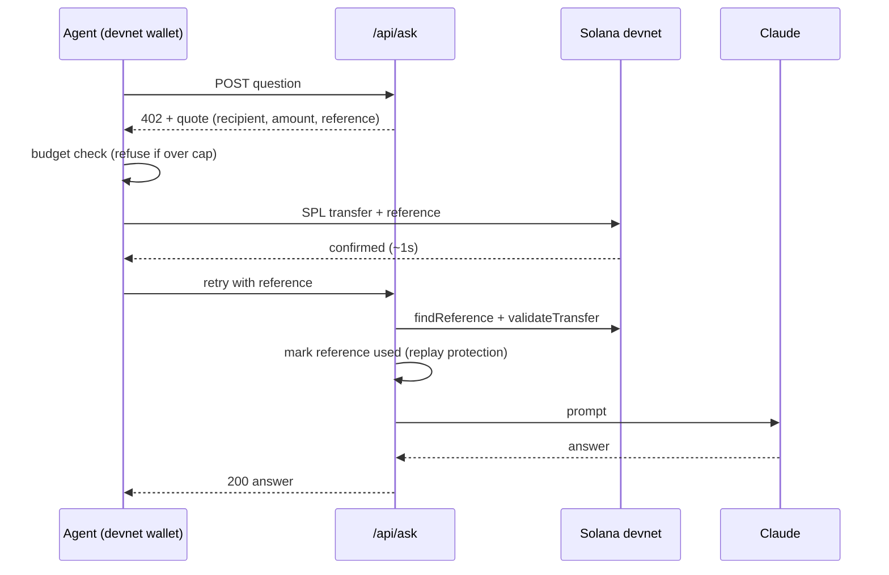

# PayPerPrompt

An AI agent with its own Solana wallet and a hard spending cap pays for every AI answer it gets, per request, on-chain.
The API says HTTP 402, the agent pays 0.001 USDC in about a second, and the answer comes back. No API keys, no subscriptions, no card.

**Demo video (1:38):** [youtu.be/_Q8L6GngaW4](https://youtu.be/_Q8L6GngaW4)

[](https://youtu.be/_Q8L6GngaW4)

## Why Solana

| | Card rail | Solana |
|---|---|---|
| Fee on a $0.001 payment | ~$0.30 fixed + 2.9% (300x the price) | ~$0.000005 |
| Settlement | days | ~1 second |
| Who can pay | humans with a card | any program or agent with a keypair |

A $0.001 request is impossible on cards: the fee is bigger than the sale. On Solana the fee is a rounding error, so pay-per-request pricing, and software that pays for software, finally works. Burst 10 requests and the agent spends one cent total.

## How it works

1. Agent calls `POST /api/ask` with a question.
2. Server answers `402 Payment Required` with a Solana Pay quote: recipient, 0.001 token, unique `reference` pubkey.
3. Agent checks its budget. Over the cap: it refuses and nothing is sent.
4. Agent sends an SPL token transfer carrying the reference (~1s, fraction of a cent).
5. Agent retries with the reference. Server runs `findReference` + `validateTransfer`, marks the reference used (one payment, one answer; replays are rejected), then calls Claude (`claude-haiku-5-5`) and returns the answer.
6. Dashboard shows the live feed, explorer links, spend vs budget and confirm latency.



## Quickstart

```bash
npm install
npm run setup     # generates devnet keypairs + writes .env.local; prints the agent pubkey
# devnet RPC airdrops are closed: fund the agent pubkey at https://faucet.solana.com, then:
npm run setup     # creates the test USDC mint, token accounts, mints 100 to the agent
# optional: add ANTHROPIC_API_KEY=... to .env.local (without it, answers are mocked)
# recommended for demos: add RPC_URL=<free devnet RPC from Helius/QuickNode>; the public devnet RPC rate-limits (429) under bursts
# optional: add DASHBOARD_PASSWORD=... to put the dashboard and agent controls behind Basic auth (set it if others can reach the app)
npm run dev       # http://localhost:3000
```

## Demo

1. Open the dashboard, ask a question: watch 402, pay, confirm, answer, with an explorer link for the transaction.
2. Click **Burst x10**: ten paid requests for one cent, each on-chain with its own latency.
3. Lower the budget cap below current spend and ask again: the agent refuses to overspend, no transaction sent.

## Limits and next steps

- State is in-memory (payments feed, used references); a restart resets it. Next: a database.
- Devnet only, and the token is a test mint, not real USDC.
- The cap is enforced by the agent process. Next: enforce it on-chain with an SPL token delegate `approve`, so even a compromised agent cannot exceed it.
- Multiple paid tools with competitive per-call pricing, so agents shop for the cheapest capable API.
- Align the 402 flow with the x402 standard so any agent or client can use it.
